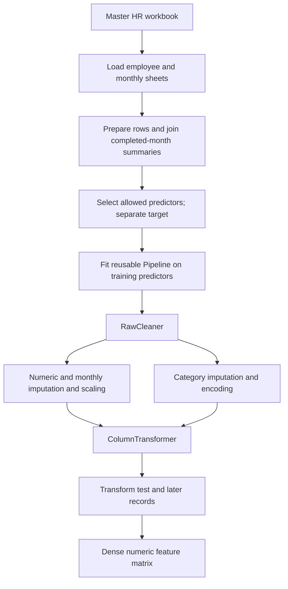

# CortexHR – Reusable HR Feature Engineering Pipeline

[](https://www.python.org/)
[](https://pandas.pydata.org/)
[](https://numpy.org/)
[](https://scikit-learn.org/)
[](https://jupyter.org/)

## Table of contents

- [Introduction](#introduction)
- [Live Demo](#live-demo)
- [Features](#features)
- [Tech Stack](#tech-stack)
- [Run It Locally](#run-it-locally)
- [Architecture](#architecture)
- [How I Verified It Works](#how-i-verified-it-works)
- [Limitations and What I Would Do Next](#limitations-and-what-i-would-do-next)
- [Phase 3 Tasks (11–15)](#phase-3-tasks-11-15)

## Introduction

CortexHR Task 2 builds a reusable preprocessing pipeline for employee-attrition analytics. It loads employee records, adds point-in-time attendance and payroll summaries, then keeps the target separate from selected predictors and converts those predictors into a numeric feature matrix for model training.

Keeping preprocessing in one fitted scikit-learn pipeline helps ensure training, test, and future records receive the same cleaning, imputation, scaling, and encoding. The pipeline is fitted on training data only; the target and columns identified as leakage or identifiers are kept out of its inputs. This repository documents a feature-engineering step, not a trained or production-ready attrition service.

## Live Demo

There is no hosted demo. The project is run locally with the supplied workbook.

## Features

- **Workbook loading:** reads the `attrition_dataset` sheet and the monthly attendance and payroll sheets from the master Excel workbook.
- **Monthly integration:** [`monthly.py`](https://github.com/dikshit0012/CortexHR-/blob/master/task%202/files/extracted/cortexhr-ml/src/cortexhr/monthly.py) joins attendance and payroll summaries by employee and observation date, using the three most recent completed months. It checks for conflicting duplicate employee-month rows and guards against multiplying employee rows or using future months.
- **Row preparation:** removes exact duplicate records and excludes negative-tenure rows pending clarification; it does not silently correct those tenures.
- **Feature selection and leakage checks:** explicitly selects predictors and rejects the target, identifiers, and known post-outcome leakage columns. The unconfirmed `dept_attrition_rate_prior_12m` feature is excluded by default.
- **Reusable cleaning and preprocessing:** [`features.py`](https://github.com/dikshit0012/CortexHR-/blob/master/task%202/files/extracted/cortexhr-ml/src/cortexhr/features.py) defines a scikit-learn `Pipeline` with `RawCleaner` and a `ColumnTransformer`. Cleaning includes location normalization, range corrections, role-based salary typo handling, `log1p` for skewed pay and overtime, and flags for never-promoted and never-raised records.
- **Missing and unseen values:** regular numeric predictors use training-set median imputation and missing indicators; monthly aggregates use median imputation and scaling. Categorical blanks become `Unknown`, and categories not seen at fit time are accepted.
- **Train and future transformation:** fit the pipeline on training predictors, then call `transform` on test or later records without refitting. The target remains a separate `y` value.

## Tech Stack

- Python 3.12 (the version used by the project Dockerfile)
- pandas, NumPy, SciPy, and openpyxl for data loading and transformation
- scikit-learn for estimators, preprocessing, and pipelines
- JupyterLab and nbconvert for notebook workflows
- pytest for automated tests

The dependency ranges are defined in the Task 2 project's [`requirements.txt`](https://github.com/dikshit0012/CortexHR-/blob/master/task%202/files/extracted/cortexhr-ml/requirements.txt); the README intentionally does not advertise unverified pinned versions.

## Run It Locally

The [Task 2 source repository](https://github.com/dikshit0012/CortexHR-) is recorded here as a Git gitlink. The parent repository has no `.gitmodules` file, so a normal clone does not fetch that source. These PowerShell commands clone the parent repository and the exact Task 2 source revision referenced by it:

```powershell
git clone https://github.com/dikshit0012/CortexHR-Phase-2.git
Set-Location CortexHR-Phase-2
git clone https://github.com/dikshit0012/CortexHR- task2-source
git -C task2-source checkout a67fdbc6d7b21d9f37f014fc017399bea7b1b6ed
Set-Location "task2-source\task 2\files\extracted\cortexhr-ml"

python -m venv .venv
.\.venv\Scripts\Activate.ps1
python -m pip install --upgrade pip
python -m pip install -r requirements.txt
```

If PowerShell blocks activation, allow it for the current PowerShell process only, then activate the environment:

```powershell
Set-ExecutionPolicy -Scope Process -ExecutionPolicy Bypass
.\.venv\Scripts\Activate.ps1
```

The master workbook is intentionally not committed; `data/raw/*.xlsx` is ignored by Git. Request an authorized copy from the project owner and place it at:

```text
data\raw\02_CortexHR_AI_ML_Dataset.xlsx
```

Do not commit the workbook or share employee-level data. The project documentation describes the workbook as fictional, but the input is still excluded from this repository. Without the workbook, the real-data pipeline run and workbook-backed tests cannot execute.

Run the Task 2 feature pipeline and its tests from the project directory:

```powershell
if (-not (Test-Path .\data\raw\02_CortexHR_AI_ML_Dataset.xlsx)) {
    throw "Place the authorized workbook at data\raw\02_CortexHR_AI_ML_Dataset.xlsx before running the pipeline."
}
python scripts/run_pipeline.py
python -m pytest -q
```

The runner fits preprocessing on the training split, transforms both train and test splits, prints their shapes and the output column count, checks for non-finite output, and saves the fitted pipeline under `data/processed/`. For a readable synthetic example that does not require the workbook:

```powershell
python -m pytest -q -s tests/test_features.py::TestThreeRows::test_three_row_end_to_end
```

[`notebooks/01_data_audit.ipynb`](https://github.com/dikshit0012/CortexHR-/blob/master/task%202/files/extracted/cortexhr-ml/notebooks/01_data_audit.ipynb) is the Task 1 audit notebook; [`scripts/run_pipeline.py`](https://github.com/dikshit0012/CortexHR-/blob/master/task%202/files/extracted/cortexhr-ml/scripts/run_pipeline.py) is the Task 2 pipeline entry point. [`tests/test_features.py`](https://github.com/dikshit0012/CortexHR-/blob/master/task%202/files/extracted/cortexhr-ml/tests/test_features.py) covers feature selection and preprocessing. The test configuration already adds `src` to the Python path.

## Architecture



## How I Verified It Works

**Verified in this workspace**

- `python -m pytest -q -rs` from the Task 2 project directory: **56 passed, 4 skipped**. The four workbook-backed tests were skipped because `data/raw/02_CortexHR_AI_ML_Dataset.xlsx` is not present. The run emitted 11 NumPy/joblib deprecation warnings.
- `python -m pytest -q -s tests/test_features.py::TestThreeRows::test_three_row_end_to_end`: **1 passed**. The synthetic fixture produced a `(3, 43)` numeric matrix with zero NaN and infinite values; the target stayed outside the feature inputs.
- `python scripts/run_pipeline.py`: checked the real-data entry point. It exited with its expected message that the workbook is missing; a real-data pipeline run was therefore not completed.

The automated tests cover synthetic feature transformation, missing-value handling, feature dimensions, train-only fitting, target and leakage exclusion, and monthly-window logic. Dataset loading and real attendance/payroll integration remain unverified in this checkout because the workbook is unavailable.

## Limitations and What I Would Do Next

- The workbook is not distributed with the code, so real-data results require an authorized local copy.
- `dept_attrition_rate_prior_12m` remains excluded until its point-in-time safety is confirmed.
- Negative-tenure rows are excluded rather than corrected while their source dates are unresolved.
- Monthly records are unavailable for some simulated historical rows; their missing summaries are imputed from training data, which can make data availability informative to a model.
- Before broader use, add explicit input-schema validation, review fairness and data-quality behavior with the data owner, and evaluate model behavior on a separately held-out dataset. Model training and deployment are outside this Task 2 pipeline.

## Phase 3 Tasks (11–15)

The `task11`–`task15` directories contain project source, tests, and configuration. Raw resumes, employee-level datasets and outputs, confidential files, and trained model artifacts are intentionally excluded; do not add them to this repository.

| Task | Focus |
|---|---|
| 11 | Resume ranking and evaluation |
| 12 | Resume fairness auditing and text preprocessing |
| 13 | Attrition model validation |
| 14 | Attrition risk scoring |
| 15 | Salary band recommendations |
